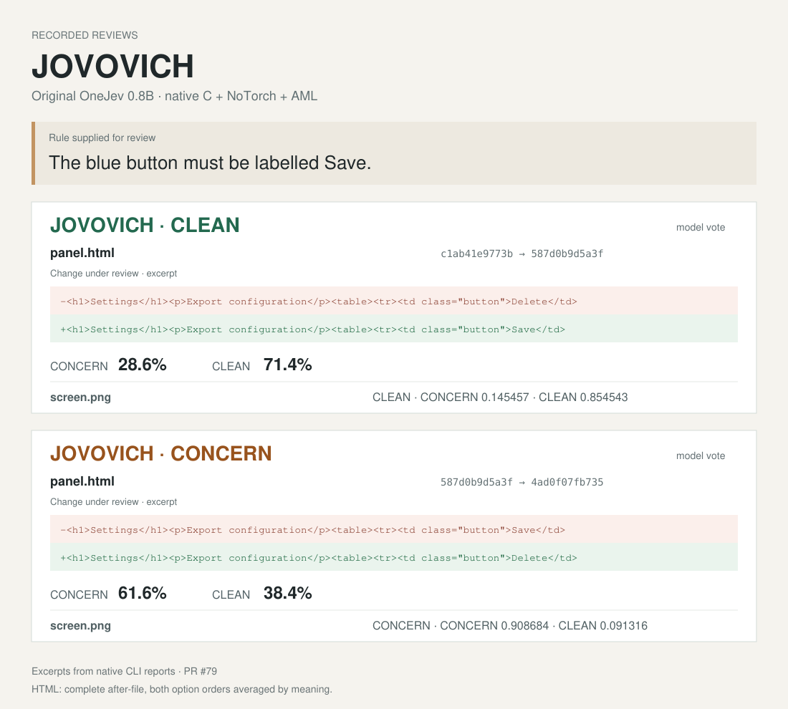

# JOVOVICH

**Juror Of Versioned Ontology, Vigilance, Integrity, Code & Heresy**

> **Read the [Arianna Method Manifesto](ARIANNA_METHOD_MANIFESTO.md) first.** This repository is governed by it; every instruction here, `CLAUDE.md` included, is subordinate to it.

> The implementation works. I am less convinced that it belongs here.

You opened a pull request. A woman with 0.8 billion parameters has opinions
about your dependency tree.

JOVOVICH is a small local review agent for Arianna Method. She reads a change
alongside the repository's own rules. She has seen markdown breeding in the
ventilation system. She would like to know who invited the seventh abstraction
layer. Sometimes the answer is perfectly good. She can say that too.

**JOVOVICH reviews. JOVOVICH does not rule.**

The merge button remains yours. The freckles are a checksum.
Refactoring them is outside the scope of this PR.

## Assemble the body

Make, a C compiler and Git with `--attr-source` support. The checks also use
Python 3, `jq` and the OpenSSL command-line tools. The two pinned dependencies are NoTorch and
Arianna Method Language (AML). The dependency tree has already been questioned.

```sh
git clone --recurse-submodules https://github.com/ariannamethod/jovovich.git
cd jovovich
make
make check
./build/review-demo
```

The demo plays back a recorded review. An existing checkout can initialize the
pinned dependencies with `git submodule update --init`. Optional BLAS builds
take `BLAS_FLAGS` and `BLAS_LIBS`. Clean the dependency objects when changing
backends.

The private JOVOVICH release contains the ready-to-run `jovovich.gguf` and
`tokenizer.gguf`. From this checkout, run
`./build/jovovich /path/to/jovovich.gguf /path/to/tokenizer.gguf < examples/reviews.jsonl`.
At startup the CLI copies both GGUFs into a private temporary directory,
checks their hashes against the manifest and loads those copies. Set
`TMPDIR` to a trusted location with room for both files (about 2 GB for the
original release). Temporary storage is released automatically when the loader or its process exits.
[Native release](https://huggingface.co/ataeff/jovovich/tree/0eac460171f26a9582d2d25dc86a96350c2a4dca)

To build those files from the source checkpoint, download
`config.json`, `model.safetensors` and `tokenizer.json` from the pinned
**OmniJev/OneJev-0.8B** snapshot. NoTorch's C converter prepares the text
weights and the tokenizer. The executable checks both file hashes at startup.
[Model snapshot](https://huggingface.co/OmniJev/OneJev-0.8B/tree/c02e305b430b56c1e82f9675ba8c293a22646891) · [Manifest](models/onejev-0.8b.json)

```sh
make -C deps/notorch qwen35_to_gguf
./deps/notorch/qwen35_to_gguf /path/to/snapshot model.gguf
./deps/notorch/qwen35_to_gguf --tokenizer /path/to/snapshot/tokenizer.json tokenizer.gguf
./build/jovovich model.gguf tokenizer.gguf < examples/reviews.jsonl
```

Run these commands from this repository's root. The live text path uses the
original unabliterated OneJev base. The host tokenizes the English prompt and NoTorch performs the F32 forward
pass. AML asks the question, scores the final A
and B logits, picks the verdict and dates it with JANUS.CALENDAR. Zero tokens
generated. Both probabilities fit on the page. [Native validation](docs/native-validation.md)

The opt-in OneJev 1.6 checkpoint uses the same tokenizer and AML prompt.
On eight pairs of comment-only edits and real regressions, it got both heads
right in all eight with paired execution evidence. The original got four.
With execution on six upstream fixes and their reversals, the original got
all six pairs right. Version 1.6 got four. On eight further fixes from five
other projects, the original cleared all eight repairs and caught all eight
reversals. Version 1.6 caught five reversals at 50% and seven at a threshold
fitted on the earlier six pairs. The original keeps the chair.
[Run 1.6](docs/onejev16.md) · [First upstream trial](docs/upstream-release-trial.md) · [Threshold transfer](docs/threshold-transfer.md)

Jovovich has also auditioned for the speaking part. She was given a swallowed
NUL and a missing submodule and informed us that the room had gone quiet.
The casting notes include every take. [First voice audition and Liquid decision screen](docs/voice-audition.md)

## Live review

Bring a diff. Bring the rule that gives her jurisdiction over it. For a whole
change, choose the rule file at the base commit and let Git supply every
changed path. This example reviews against lines 1–3 of that file.

```sh
set -e
./build/jovovich-pack --all /path/to/repo BASE HEAD RULES.md 1 3 > batch.jsonl
./build/jovovich model.gguf tokenizer.gguf --json < batch.jsonl > answers.jsonl
./build/jovovich-report batch.jsonl answers.jsonl
```

Her English answer opens with **CONCERN** or **CLEAN** and quotes the rule and
the patch. When two executions differ, the host can show her the required
effect and what the new code actually did. In the recorded `draw.c` repair,
both versions behaved at mode 0. At mode 1 the patch restored `scan → paint`.
Her vote was **CLEAN 69.0% · CONCERN 31.0%**.
[Recorded answer](examples/run-selection/git-answer.jsonl) · [Operating rules](docs/operating-rules.md) · [Whole-change reports](docs/batch-review.md)

The rule says **Save**. Replace **Delete** with **Save**: **CLEAN 71.4%**.
Put **Delete** back: **CONCERN 61.6%**. She reviews the committed images
alongside the HTML, too.



Excerpts from the native CLI reports in [PR #79](https://github.com/ariannamethod/jovovich/pull/79),
with the original scores and Git revisions.

## Image decisions

The original OneJev checkpoint includes its Qwen3.5 vision encoder. From the
same pinned source snapshot, also download `processor_config.json`, then build
the 201 MB image pack:

```sh
make -C deps/notorch qwen35_to_gguf
deps/notorch/qwen35_to_gguf --vision /path/to/snapshot vision.gguf
./build/jovovich /path/to/jovovich.gguf /path/to/tokenizer.gguf --vision vision.gguf < images.jsonl
```

Each JSONL row names an image, its SHA-256, a question and two explicit choices:

```json
{"id":"screen-1","image":{"path":"screen.png","sha256":"<SHA-256 of the image file>"},"question":"Which button is visible?","choice_a":"Save","choice_b":"Cancel"}
```

The text/vision pair is pinned by `models/onejev-0.8b-vision.json`. Image bytes
are captured and verified before decoding. NoTorch resizes RGB at a 262144-pixel
budget, encodes the image and supplies its feature rows and three-axis positions
to the unchanged original text model. AML uses the OneJev state/question/options
frame, scores A/B and attaches a JANUS instant. User-provided control-token
spellings remain literal text.

The `jovovich.visual-choice/1` result includes the selected letter, logits,
probabilities, input/prompt/image/model hashes, original/resized dimensions and
visual-token count.

For persistent visual observations, add `--visual-memory DIR` and a `remember`
object naming the logical repository, PR, exact Git commit and image path.
The image must match that committed regular file. Corrections name the previous
receipt; `jovovich-replay visual` retrieves current or historical observations,
and `--recall-visual DIR` lets OneJev answer new A/B questions from the selected
receipt after restart. [Visual memory](docs/fact-memory.md#remember-an-image-observation)

`--compare-visual DIR` reads two exact observations and the repository rule
from their Git base, then asks OneJev whether the after image satisfies it.
The answer carries both image receipts, the quoted rule and CLEAN/CONCERN
scores. [Compare a visual change](docs/fact-memory.md#compare-a-visual-change)

`--with-visual` includes those comparisons in a whole-change PR report. The
packer requires one verified comparison for every changed binary image and
keeps each text patch in the same manifest. Any visual CONCERN contributes to
the aggregate; the report retains the image observations and remembered rule.
[Combine text and visual reviews](docs/batch-review.md#combine-text-and-visual-reviews)

`make check-visual MODEL=/path/to/model.gguf VISION=/path/to/vision.gguf` runs
real image substitution, both option orders, literal markers and altered-byte
refusals. The existing review invocation and text manifests retain their bytes.

## She remembers the rule

Her memory takes a cue from [LALO](https://github.com/ariannamethod/lalo):
keep the fact, its source and its corrections. JOVOVICH keeps her own journal
in AML. Give a rule a name in one review and she can bring it to the next. Every
receipt keeps the exact words, the Git review they came from and when she
learned them. A correction points to the receipt it supersedes.

```sh
mkdir -p build/memory
./build/jovovich-pack --remember build/memory studio/render draw-order \
  --all /path/to/repo FIRST_BASE FIRST_HEAD RULES.md 2 2 > first.jsonl
./build/jovovich-pack --recall build/memory studio/render draw-order \
  --all /path/to/repo NEXT_BASE NEXT_HEAD > next.jsonl
./build/jovovich model.gguf tokenizer.gguf --json < next.jsonl > next-answers.jsonl
./build/jovovich-report next.jsonl next-answers.jsonl
```

The next review fetches the named rule and checks its exact quotation against
its own base commit. Its answer carries the earlier source beside the current
patch. You can still ask what she knew at receipt 1 after receipt 2 arrived.
[Fact memory and corrections](docs/fact-memory.md)

She can also remember which input exposed a previous bug. If a later patch
touches the same file under the same named rule, the replay host takes that
input back to the bench. It runs the new base and head and asks the current
contract what should have happened. The report names the review where she
first saw the case. [Remember and replay a counterexample](docs/counterexamples.md)

Complete text-and-image reviews can stay in that PR's history: original inputs,
her answers and their dated receipts, separated by repository and PR number.
After a restart, she can retrieve the exact review.
[Keep a mixed review](docs/batch-review.md#keep-a-mixed-review-in-the-prs-aml-history)

She can compare two remembered reviews, file by file: where her verdict changed,
where it held, and where the rule or model changed between visits.
[Compare her decisions](docs/batch-review.md#compare-two-recorded-reviews)

Her next report can bring those earlier verdicts to the table. Each file keeps
its previous answer, its current answer and what changed between them.
[Include the previous review](docs/batch-review.md#bring-the-previous-review-into-the-report)

The log is singular. She is watching.
[JOVOVICHLOG](JOVOVICHLOG.md) · [Arianna Method Manifesto](ARIANNA_METHOD_MANIFESTO.md) · [305-token speed measurements](docs/review-latency.md)

*Methodologically clean. Mild heresy.*

*Dependency tree questioned. Freckles intact.*
